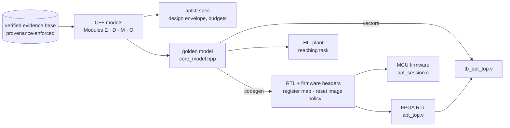

# APT — the Artificial Peripheral Thalamus device suite

C++20 / C99 / Verilog implementation of the device layer of *The Cybernetic Neuromorphic
Framework* (Modules E, M and O, with the parts of D they depend on): the analysis that
specifies the device, a bit-exact model of its datapath, the FPGA that implements it, and the
supervisory firmware that runs it.

Each layer is checked against the layer above it:

* the **C++ models** reproduce the manuscript's published device-layer outputs,
* the **golden model** fixes the datapath to the bit,
* the **RTL** reproduces the golden model byte for byte in co-simulation, and
* the **firmware** is generated from the same register map and dosing constants.



## What is in it

| Layer | Where | What it does |
|---|---|---|
| Evidence base | `include/apt/evidence.hpp` | Loads the verified tables (vendored from the project dataset). An `UNVERIFIED` cell raises instead of being imputed, and duplicate parameter names refuse to load (the same rules as `kcore.getp`). Every read goes into a ledger. Unsourced design constants are declared through a `StructuralRegistry` and reported next to it. |
| Module E | `afferent.hpp`, `stability.hpp`, `recovery.hpp` | Afferent channel rates; the latency→learning law fixed exactly by two verified points; the delayed-admittance stability envelope; the Colgate–Schenkel passivity bound; the design envelope, the dose-for-MDC table, and the matched-dose latency contrast. The contrast **requires** a reference latency, and the API has no function that returns a device-versus-therapy effect size, because the evidence base cannot support one (§4.6). |
| Module M | `schedule.hpp` | Exact backward induction over (ceiling, budget), using the verified threshold dose-response. |
| Module O / §3.16 | `afferent.hpp`, `dsp.hpp` | Sensing specification; Butterworth/notch design with exact group delay; the sample-to-actuation latency budget; and the Pareto front of filter order and cut-off against artefact rejection. |
| Fixed-point contract | `fixed.hpp` | Q12.20 signals and Q8.24 coefficients. Products are exact in 64 bits, rounded once (round half up) and saturated. The RTL and the firmware use the same rules. |
| Golden model | `core_model.hpp` | One control tick, specified step by step: ADC scaling, DF-I biquad, kinematics, latched safety supervisor, Hannaford–Ryu passivity observer/controller, admittance law, slew-limited inner loop, and LIF afferent encoding with paired-pulse gating at the verified 30 ms / 0.4. |
| HIL | `plant.hpp` | Device carriage, compliant coupling and impedance-driven hand on a minimum-jerk reaching task. Sensors are quantised the way the hardware quantises them, and a transport delay can be injected. |
| RTL | `rtl/` | `apt_core` (one shared 32×32 MAC driven by an FSM that mirrors the golden model), a 64-cycle divider, an AD7606-class SPI ADC sequencer, a quadrature decoder, a centre-aligned H-bridge PWM with dead-time, charge-balanced biphasic stimulators, a latency monitor, an SPI CSR slave, and CRC-16/SLIP/UART telemetry. |
| Firmware | `fw/` | Session supervisor (BOOT/IDLE/ARMED/ACTIVE/FAULT/LOCKOUT), heartbeat, fault policy, latency audit, a threshold-aware weekly dose ledger, the Module M policy lookup, and the telemetry decoder. |
| Codegen | `aptctl codegen` | Emits `rtl/generated/*.vh` and `fw/include/apt_{regmap,params,policy}.h` from the C++ register map, configuration and models, so the three layers cannot drift apart. |

## Results (all reproduced by the commands below)

**Reproduction of the manuscript's device layer**

| Quantity | Manuscript | This suite |
|---|---|---|
| Stability envelope, max stable stiffness at 1–300 ms | `E_stability_envelope.csv` | identical to 1e-9 |
| Half-rate latency of the learning law | 152 ms | 152.05 ms (exact) |
| Afferent rate, biological / device | 214 / 658 bit/s | 214 / 658 bit/s |
| Sensing specification | 15.0–19.4 bits, 500–646 bit/s | 15.0–19.4 bits, 500–646 bit/s |
| Dose exponent γ | 1.044 | 1.049 (Monte-Carlo cohort) |
| Dose for MDC vs latency | `E_dose_for_mcid.csv` | within one rung of the 1.08× search ladder at every latency |
| 10 ms latency contrast across reference latencies 30–300 ms | SMD 0.12 → 1.08 | 0.12 → 1.10 |
| Dose threshold | 1.72× usual care | 1.723× |
| Contact time to threshold, usual-care rate / device rate | 43 / 4 min per week | 43.4 / 4.3 min per week |
| Share of draws in which a threshold above usual care exists | 90% | 88–90% |
| 20 h budget, spread evenly / concentrated | 0 / 6.6 FM, P(≥MCID) = 0.81 | 0 / 6.6 FM, P(≥MCID) = 0.82 |
| Epoch ordering, acute : subacute : chronic | 0.68 : 1 : 0.47 | 0.68 : 1 : 0.47 |

**Hardware co-design**

* **RTL against the golden model:** 1200 of 1200 telemetry frames identical byte for byte, with 0 CRC errors. The run includes 163 ticks with the passivity controller active (which exercises the divider), an e-stop, and a fault cleared over SPI.
* **Latency measured on the RTL:** sample→PWM is at most 54 µs and sample→stimulus at most 18 µs. The electronics are therefore negligible against the 10 ms budget. The causal front-end filter dominates it (3.1 ms worst in-band group delay at 80 Hz), which is the trade-off §3.16 describes.
* **Invariants:** the stimulators are charge-balanced on all four channels, including pulses interrupted by a disable. There is no H-bridge shoot-through. The e-stop removes all gate drive within 80 ns. The host watchdog trips as specified.
* **Synthesis** (Yosys `synth_xilinx`, XC7): about 8.5k LUTs, 8.5k FFs and 5 DSP48E1, with `check -assert` clean. That fits an XC7A35T. No timing closure has been run (see `syn/report_xc7.txt`).
* **Firmware:** 497 host checks pass, with no warnings under `-Wall -Wextra -Wpedantic -Wconversion`.

**A finding the HIL produced.** Rendering a virtual mass below the physical carriage mass is unstable at every latency. That is the case for the manuscript's 0.25 kg analysis constant against a 0.8 kg carriage, and it is the classic coupled-stability limit of admittance control. A rendering of 1 kg with 20 N·s/m is stable up to 40 ms of transport delay and loses stability by 50 ms. With the Hannaford–Ryu controller enabled, port energy stays at about −0.0005 mJ, against up to −0.57 mJ without it. The controller cannot rescue a loop whose delay is past the envelope; at that point the supervisor trips. `DesignPoint` records this.

## Beyond reproduction: three results that go past the manuscript

### 1. The safety claims are proved, not only simulated (`formal/`, SymbiYosys + z3)

Simulation shows that a property held on the vectors that were run; k-induction shows it holds for every input.
`scripts/formal.sh` runs these proofs (about 15 s in total):

| Proof | Statement | Scope |
|---|---|---|
| `stim_balance` | net charge (cathodic − anodic cycles) is zero whenever no pulse is in flight | all widths, gaps, refractory values and CSR writes at any time |
| `pwm` | no shoot-through on either leg; a gate turns on only after its complement has been off for `DEADTIME` cycles; all four gates are off the cycle after `enable` falls | unbounded |
| `safety_chain` | with every datapath input free, a latched fault or the e-stop removes all gate drives and any new stimulus pulse on the next clock | unbounded |
| `udiv` | the restoring divider satisfies `quotient·D + r = N` and `r < D` | **N = 8, M = 4 only** — the 64/32 induction is beyond z3's nonlinear bit-vector reasoning; the RTL is width-generic and the 1200-frame co-simulation exercises the full width |

**The first run found a real defect.** The stimulator re-read the CSR pulse width in both phases, so rewriting `STIM_WIDTH`
mid-pulse produced unequal cathodic and anodic phases — an unbalanced pulse, which the module header claimed was impossible.
The width is now latched at trigger; the proof above is the one that then went through. The simulation had never
rewritten the register mid-pulse, so it could not have found this.

### 2. A latency-adaptive controller, certified in closed loop (`adapt.hpp`, `fw/src/apt_adapt.c`)

The HIL shows that as transport delay grows, the first thing to fail is the **inner position loop** (a PD law closed
around a delayed measurement), not the rendered admittance. Raising the rendered damping buys about 20 ms; scaling the inner
gains buys more than 150 ms. The safe scale falls roughly as 1/τ², the delay-limited crossover of a PD loop.

The schedule is *certified* rather than tuned: for each delay bin the largest gain scale on a ladder is chosen such that the
closed-loop HIL is stable at 1.25× the bin's delay **and** at 1.5× the scale, over three seeds. The MCU measures link delay
(heartbeat round trip), keeps a one-sided estimate (instant attack, slow release), and rewrites `KP`/`KD` over the CSR bus —
down at once, back up only after 500 ms of evidence — and reports when the delay is beyond the certified range.

| link delay | fixed gains | adaptive (scale) | device-to-command tracking, fixed → adaptive |
|---|---|---|---|
| 40 ms | stable | stable (×0.80) | 5.4 → 6.1 mm |
| 60 ms | **unstable** | stable (×0.41) | 20.3 → 10.1 mm |
| 100 ms | **unstable** | stable (×0.21) | 30.1 → 16.5 mm |
| 200 ms | **unstable** | stable (×0.044) | 46.7 → 29.3 mm |

An unannounced 10 → 120 → 30 ms step trips the fixed controller and not the adaptive one (`aptctl adapt`). **The price:** the
device follows its own command more loosely as gains drop, and this is reported, not hidden. Whether that loosening matters to
learning is not something any verified quantity says, so the digital twin below carries it as a separate axis.

### 3. A closed-loop digital twin (`twin.hpp`, `aptctl twin`)

`device design → link delay → does the session complete (HIL stability map) → effective hours (latency-to-learning law)
→ ceiling raise (Module M threshold dose-response) → capacity (Module D window) → Fugl-Meyer gain`, on common random
numbers: the same virtual patients, link draws and noise for every controller policy. It is a **contrast between device
configurations under a stated link scenario and reference latency**, never a device-versus-therapy effect.

What it says (3000 patients, home-link spread and 2 % congestion included):

* The fixed design stops completing sessions at 50 ms; a conservatively-gained fixed design at 95 ms; the adaptive one at 205 ms.
* **Dose saturates.** At the default 12 weeks × 5 × 0.5 h, a median link of 40 ms leaves only 56 % of sessions completing under
  fixed gains, yet the gain barely moves (3.04 vs 3.26 FM). The controller's robustness matters in the tail: at a 100 ms
  median the fixed design completes 9 % of sessions and delivers 1.4 FM against 3.2 FM for the adaptive one.
* **At low dose it matters sooner.** With 3 × 1.8 min per week, a 40 ms median already costs 1.9 FM (fixed) vs 3.1 (adaptive).
* A conservatively-gained *fixed* design buys robustness by paying the transparency cost at every delay (7.9 mm at 10 ms,
  against 4.1 mm for the adaptive one); the adaptive design pays it only when it has to.

## Build and run

```sh
cmake -S . -B build -G Ninja && cmake --build build
ctest --test-dir build                      # 13 suites: models, golden model, HIL, adaptation, twin, firmware
build/aptctl spec --out out/spec            # the device specification + CSV tables
build/aptctl schedule --budget 20           # Module M optimal schedule
build/aptctl hil --latency 30               # closed-loop trace of the fixed-point controller
build/aptctl adapt                          # certify the latency-adaptive schedule; fixed vs adaptive
build/aptctl twin --hours 0.03 --sessions 3 # digital twin: link scenario -> sessions -> dose -> outcome
build/aptctl codegen --root .               # regenerate RTL/firmware headers (incl. the certified table)
scripts/sim.sh build                        # vectors + Icarus Verilog co-simulation (needs iverilog >= 11)
scripts/formal.sh                           # formal proofs (needs sby, yosys, yosys-smtbmc, z3)
yosys -s syn/synth_xc7.ys                   # synthesis (Yosys >= 0.30)
```

The suite has no dependencies beyond a C++20 compiler and CMake. It finds the evidence base under `data/` (override with `$APT_DATA`).

## Boundaries, stated as plainly as the results

This suite inherits the manuscript's limits and adds some of its own.

* **There is no device-versus-therapy effect size.** The only latency output is a contrast between device configurations at a stated reference latency, because nothing verified fixes the feedback latency of conventional therapy (§4.6). The dose threshold is conditional on its existing, which happens in about 90% of draws. The device repetition rate is a rate a therapist-delivered protocol achieved, not a measured property of any device (§4.15).
* **Several constants are design choices, not evidence.** This covers the HIL plant (carriage mass, coupling compliance, hand impedance) and the `DesignPoint` values (filter cut-off, gains, rendered mass, LIF gains). They are engineering choices for this design point, not verified quantities. The constants the Module E/O code uses are listed by `aptctl spec` under "structural (unsourced)". The plant and design-point values are documented in their headers.
* **The adaptive controller and the twin inherit the HIL's plant.** The carriage, coupling and hand are engineering
  choices (see above), so the certified delay limits are for *this* plant. The certification procedure transfers; the
  numbers must be re-derived on a characterised bench. The twin's link-delay distribution, session protocol and reference
  latency are declared structural constants (`aptctl twin` lists them), not evidence. Failed sessions are assumed not to
  change adherence, and the adaptive controller's looser tracking is reported but not converted into a learning penalty.
* **The divider is proved only at reduced width** (8/4); the 64/32 instance rests on the width-generic RTL and co-simulation.
* **The hardware has only been verified in simulation (and, for the properties above, formally).** The RTL has been checked by simulation and synthesis only, not on silicon. The ADC, encoder and bridge are behavioural models in the testbench. Clinical use would need, at minimum, bench characterisation of the transducer and filter in a representative noise environment (§3.16, §5.8), timing closure, and an independent safety assessment. One author declares a commercial interest in this interface class, and the manuscript recommends that any trial of these predictions be run independently of both authors.
